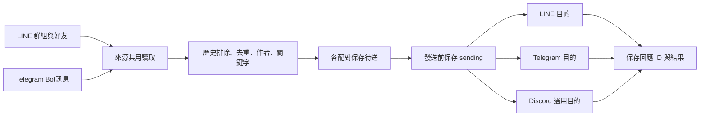

# LinePort

在 Windows 背景轉送 LINE 與 Telegram 訊息。支援多來源、多目的、指定發訊者、內容篩選及選用的 Discord 文字目的。

v0.8.3 改善 LINE 混合頁面補讀，並顯示每條路線的已處理、新候選與條件排除數，方便排查未轉送原因。161 項模擬測試通過；本次未收件的真機原因仍待確認。[本次更新](docs/RELEASE-0.8.3.md)

[下載 v0.8.3 ZIP](https://github.com/b40609/LinePort/releases/download/v0.8.3/LinePort-v0.8.3.zip) · [更新與 SHA-256](docs/RELEASE-0.8.3.md) · [使用教學](docs/USAGE.md) · [多來源與篩選](docs/ROUTING.md) · [支援範圍](docs/DEVELOPMENT-STATUS.md) · [安全說明](SECURITY.md) · [交接](HANDOFF.md)

[手機示範畫面](https://raw.githubusercontent.com/b40609/LinePort/v0.7.2/docs/assets/preview-mobile-0.7.jpg)（v0.7.2 歷史畫面；名稱、ID、訊息均為假資料）。

## 功能

- **多來源、多目的**：每個來源轉到所有選取目的；可建立多條規則，分別啟用或暫停。
- **跨通訊平台**：LINE／Telegram 可轉送到 LINE、Telegram 或選用 Discord 一般文字頻道；Discord 只作目的。
- **群組與個人**：LINE 已加入群組與好友；Telegram Bot 可存取的群組、頻道與私訊。
- **文字篩選**：包含／排除關鍵字、加上訊息前綴。
- **指定發訊者**：每個來源各選固定發訊者 ID；LINE 可勾選已加入成員，Telegram 列最近發訊者。名稱改變不影響，貼圖不轉送。搭配訊息關鍵字排除純寒暄。
- **選用時段與媒體**：台北時段外明確保留待送或略過；Telegram → Telegram 圖片／檔案；Telegram → LINE 支援 JPEG／PNG 圖片，說明另送。
- **管理與保護**：規則搜尋、複製為暫停規則、各來源文字／媒體模擬、安全診斷、設定備份還原、容量監控及保留原檔的私人封存與 SHA-256 驗證。
- **選用回覆關聯**：引用同路線已確認送達的原訊息，重啟保留對照；缺少對照時送一般訊息，不補送被篩掉的原訊息。
- **獨立狀態**：各來源讀取診斷，各配對待送、成功與略過數；一個目的受阻時，其他配對繼續。
- **保存與去重**：首次略過歷史，同一規則重啟沿用紀錄；以平台與聊天室 ID 辨識，同名群組可分開選。
- **LINE 補讀**：近期 50 則不足時，分頁查詢；最多 1,000 則，無法追到基準時顯示錯誤。
- **安全預覽**：LINE 最近訊息與 JSON 匯出，不負責發送。
- **LINE 已讀行為實測**：本次三則文字轉送皆收到、來源已讀維持 0；同帳號用官方 LINE 開啟來源後變成 1。可讓來源閱讀操作留給使用者；結果限本次版本與條件。[測試過程、對照與限制](docs/READ-RECEIPT-2026-10-10.md)

| 項目 | 支援範圍 |
| --- | --- |
| 系統 | Windows 11；實測 Node.js 26.4.0 |
| LINE | 非官方個人帳號協定；已加入的一般群組、好友私訊 |
| Telegram | 官方 Bot API；Bot 有權限讀取／發送的聊天室 |
|訊息 | 可讀純文字；選用 Telegram → Telegram 圖片／檔案、Telegram → LINE 圖片；目的仍以本工具帳號發送 |
| 規則上限 | 30 條；每條 1–10 個來源、1–10 個目的；合計最多 100 組啟用配對 |
| 未支援 | LINE 社群 OpenChat、Slack、Discord 來源、LINE 來源附件、LINE 目的檔案、貼圖、相簿整組／影音、編輯／刪除同步、完整聊天封存 |

## 快速開始

需要與官方電腦版 LINE 同時使用，可先試 [iPad 登入身分實驗模式](docs/IPAD-EXPERIMENT.md)。**這是 LINE 協定身分，無需實體 iPad，也不限定 iPhone；目前 LinePort 主機仍只支援 Windows。** 使用理由與驗證範圍見下方說明；此功能位於 `master` 原始碼，既有 v0.8.3 發布 ZIP 尚未包含。

安裝 [Node.js](https://nodejs.org/)，下載並解壓縮本專案。在專案目錄開啟 PowerShell：

```powershell
cd yomi-probe
npm.cmd ci --ignore-scripts
npm.cmd start
```

開啟 http://127.0.0.1:18765/：

1. 使用 LINE 時，完成手機授權或恢復登入，按「載入 LINE 群組與好友」。
2. 使用 Telegram 時，在頁面連結並保存自己的 Bot Token，再載入 Bot 聊天室或手動加入 ID。
3. 選取來源與目的，按住 Ctrl 可多選，按「新增並保存規則」。
4. 按「開始轉送」，等基準完成後，在來源發新文字確認目的收到。

只使用 Telegram 時不必登入 LINE。Telegram 來源是 Bot 可收到的訊息，並非登入個人 Telegram 帳號讀取所有聊天。電腦需保持連網、不休眠。

[安裝教學](docs/INSTALL.md) · [Telegram 權限與設定](docs/USAGE.md#telegram) · [舊版更新](docs/USAGE.md#更新)

## 為何新增 iPad 登入身分？解決什麼問題？

使用者回報：啟動 LinePort 後，同帳號的官方電腦版 LINE 被強制登出，影響工作。原本 `DESKTOPMAC` 使用桌面登入身分；依症狀推測與官方電腦版的追加裝置登入衝突有關，尚無證據顯示是滑鼠／鍵盤操控權被搶走。LINE 官方也將「於其他追加裝置登入」列為自動登出的可能原因，但未保證任意裝置組合都能共存。[官方登出問題說明](https://help.line.me/line/smartphone/?contentId=50001462&lang=zh-Hant)

本次新增 `IOSIPAD`，讓 LinePort 使用另一種追加裝置登入身分，嘗試保留官方電腦版的登入。這是可選實驗模式，預設仍為原桌面模式；失敗時不自動切回桌面登入，避免再次影響使用者。除了變更身分，也新增符合該身分的 QR／PIN 流程，以及獨立憑證、E2EE 與設定目錄。

| 問題／能力 | 本次結果 |
| --- | --- |
| LinePort 與官方電腦版能否同時登入 | 單一真實帳號通過；使用者確認官方電腦版仍能正常收發 |
| LinePort 能否載入群組／好友、重啟後恢復登入 | 同一帳號通過，無需重掃 QR |
| 只改 iPad 身分仍無法完成授權 | 已改為對應的 QR 流程並完成該帳號登入；先前 code 0／4 的嘗試與修正見實驗紀錄 |
| iPad 模式實際訊息解密、轉送與長期共存 | 尚待實機驗收；不能沿用桌面模式結果當作通過 |
| Android／iPhone、官方 Windows／Mac 及既有平板等不同組合 | 不依主要裝置品牌限制登入；其他組合仍待實測，不保證全部共存 |

軟體設計分開處理 **LinePort 主機作業系統、LINE 主要裝置、LINE 協定登入身分**。`IOSIPAD` 中的 iOS 版本是協定欄位，並非要求使用者手機安裝該版本；同理，`DESKTOPMAC` 不代表只能在 Mac 上執行。官方列出可作主要／追加裝置的多種平台，但官方 App 支援不等於本非官方工具已完成相容性驗證。[LINE 官方裝置說明](https://help.line.me/line/smartphone/sp?contentId=20000132&lang=zh-Hant)

Windows 執行支援目前由 PowerShell 啟動器、ACL 與選用 DPAPI 實作，macOS／Linux 尚未移植。[相容性矩陣與設計原則](docs/COMPATIBILITY.md) · [iPad 操作、排查與完整紀錄](docs/IPAD-EXPERIMENT.md) · [200 項測試與實機驗收範圍](docs/ACCEPTANCE-2026-10-21.md)

## 運作方式

LINE 透過 [Yomi](https://github.com/RikaiDev/yomi) 讀取／解密及加密發送；Telegram 使用 [官方 Bot API](https://core.telegram.org/bots/api)。本專案負責規則、輪詢、篩選與保存，不需要 AI。



各來源與待送佇列分開輪詢，完成後等待 3 秒；同一目的依序發送，間隔至少 1.1 秒。來源讀取失敗採退避重試；Telegram／Discord 明確限流保存等待期限，其他發送結果不明則持續暫停該配對，重啟也不自動重送。重複配對、自我轉送與規則循環會被阻擋；工具自己送出的訊息另保存 ID，避免再次接力轉送。

## 使用限制

- LINE 使用非官方個人帳號協定，有功能限制或停權風險；登入可能使官方電腦版 LINE 登出。[LINE 條款](https://terms.line.me/line_terms?lang=zh-Hant)
- 目的訊息由登入 LINE 帳號或 Telegram Bot 重新發送，不保留原發訊者身分。
- 休眠、斷線、查詢上限、首次基準與發送結果不明皆可能造成漏訊，沒有完整送達保證。
- Telegram 受 Bot 權限、隱私模式、其他輪詢程序與 Webhook 影響；受保護內容及 Bot訊息不轉送。
- Bot Token 可選 Windows DPAPI；舊明文檔為回復保留，LINE 登入／E2EE、訊息與封存仍未加密。勿分享或雲端同步資料目錄。
- 單一紀錄 16 MiB、盤點紀錄合計 256 MiB 或可用空間低於 64 MiB 時停止收件／發送。封存不刪原檔、不釋放容量；尚無自動壓縮與無限期運作保證。

已完成一次 LINE → LINE 人工驗收，共三則文字轉送與已讀正向對照；多目的、跨平台及長時間運作仍待真實驗收。[已讀實測](docs/READ-RECEIPT-2026-10-10.md) · [驗證紀錄](yomi-probe/VERIFICATION.md)

## 開發與文件

```powershell
cd yomi-probe
npm.cmd test
```

測試使用模擬服務，不讀取真實登入資料、不發真實 LINE／Telegram訊息。介面模擬可執行 `node ui-mock.mjs`，使用 18767 埠。

[疑難排解](docs/TROUBLESHOOTING.md) · [架構](docs/ARCHITECTURE.md) · [安全](SECURITY.md)

現行程式位於 `yomi-probe/`。`src/`、`scripts/`、`package/` 為早期 Windows 通知診斷實驗。[早期單配對流程示範](docs/flow.html) 保留作參考。

## 授權

[MIT License](LICENSE)。核心依賴 `@rikaidev/yomi` 0.5.0，MIT，Copyright 2026 RikaiDev；見 [第三方聲明](THIRD_PARTY_NOTICES.md)。本工具與 LINE、Yomi 無官方關係。
