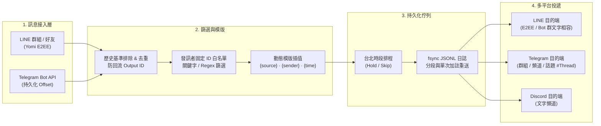

<div align="center">

# ⇄ LinePort

**Windows 本機跨平台即時通訊路由與訊息中繼工具**<br>
*LINE · Telegram (含 Forum Topics) · Discord — 本機運作、端對端加密相容、無外部雲端中轉*

[](https://github.com/b40609/LinePort/releases/tag/v1.2.0)
[](https://github.com/b40609/LinePort/releases)
[](yomi-probe/VERIFICATION.md)
[](SECURITY.md)
[](LICENSE)

[下載與安裝](#-下載安裝版與免安裝版) · [功能與架構重點](#-功能與架構重點) · [快速上手](#-快速上手) · [進階篩選與模版](#-進階篩選與動態模版語法) · [裝置共存策略](#-line-雙協定身分與官方電腦版共存策略) · [系統邊界與限制](#-平台支援規格與系統邊界) · [資安與驗證](#-資安邊界與自動化測試)

</div>

---

## 📦 下載（安裝版與免安裝版）

LinePort v1.2.0 提供兩種內建執行環境（Node.js 與 .NET Windows Desktop Runtime）的 Windows x64 套件，不需另行安裝開發工具（EXE 未簽署數位憑證；需登入 Windows 使用者工作階段才會運作）：

| 發行版本 | 適用對象 | 特性與啟動方式 | 下載連結 |
| :--- | :--- | :--- | :--- |
| **Windows 安裝版**<br>`Setup.exe` | **一般安裝使用** | 免管理員權限安裝至目前使用者目錄；建立桌面與開始功能表捷徑、系統匣狀態燈常駐、支援登入 Windows 自動啟動與舊版平滑切換。 | [**下載 v1.2.0 安裝版 EXE**](https://github.com/b40609/LinePort/releases/download/v1.2.0/LinePort-v1.2.0-Windows-x64-Setup.exe) |
| **Windows 免安裝版**<br>`Windows-x64.zip` | **免安裝解壓使用** | 完整解壓至獨立資料夾後雙擊 `LinePort.exe` 即可啟動背景服務、系統匣狀態燈與本機設定頁。 | [**下載 v1.2.0 免安裝 ZIP**](https://github.com/b40609/LinePort/releases/download/v1.2.0/LinePort-v1.2.0-Windows-x64.zip) |

> **版本資訊與校驗**：[v1.2.0 更新說明與限制](docs/RELEASE-1.2.0.md) · [SHA256SUMS.txt 校驗檔](https://github.com/b40609/LinePort/releases/download/v1.2.0/SHA256SUMS.txt) · [原始碼壓縮包](https://github.com/b40609/LinePort/releases/download/v1.2.0/LinePort-v1.2.0.zip) · [安裝與升級說明](docs/PORTABLE.md)

---

## ✨ 功能與架構重點

### 1. 多來源對多目的路由（M × N Routing）
- **規則容量**：支援最多 30 條規則（每條規則 1–10 個來源、1–10 個目的，最高 100 組啟用配對），禁止回流循環。
- **支援平台**：
  - **LINE**：支援已加入的一般群組、好友私訊；目的端預設使用 Letter Sealing (E2EE) 加密，若偵測到群組內含不支援 E2EE 之官方帳號／Bot，自動切換為傳輸加密純文字相容模式。
  - **Telegram**：基於官方 Bot API，支援群組、頻道、私訊與 **Forum Topics（指定話題 `threadId`）**。
  - **Discord**：支援伺服器一般文字頻道作為轉發目的（實驗支援，正式環境尚未實機連結），預設關閉提及與外連預覽。

### 2. 動態訊息模版與篩選規則
- **變數插值**：支援於前綴或自訂模版嵌入 `{source}`、`{sender}`、`{date}`、`{time}`、`{timeShort}`、`{text}`。
- **關鍵字與發訊者白名單**：支援多行 `OR`、單行 `詞A + 詞B`（AND）與 `/pattern/i` 正規表達式（建議避免巢狀量詞以免回溯耗時），並可依固定成員 ID 篩選發訊者。
- **規則預覽工具**：內建離線模擬器，可預覽關鍵字篩選與模版文字排版結果（模擬不讀取真實回覆對照，附件使用合成長度資訊）。

### 3. LINE 雙協定身分
- 提供 **`IOSIPAD`（iPad QR 協定身分）** 與 **`DESKTOPMAC`（桌面授權身分）** 切換，各身分的憑證、金鑰與規則存放在獨立的 `%LOCALAPPDATA%` 子目錄。
- 選用 `IOSIPAD` 身分可避免與同一台電腦上的官方 Windows 電腦版 LINE 互踢（若原本有使用實體 iPad 登入同帳號，實體 iPad 會登出）。
- **已讀行為**：依 v0.7.2 文字實測紀錄，背景讀取不會主動送出已讀回條（跨版本與附件情境**待驗證**）。

### 4. 持久化佇列、發送語意與監控
- **兩階段 JSONL 持久化**：每筆訊息先寫入 `queued`／`media_queued` 並 `fsync` 才推進游標，發送前寫入 `sending`。
- **發送失敗分類與重送策略**：
  - **確定未送出**（DNS／拒絕連線／TLS、送出前驗證失敗、平台明確回傳 401／403／400 聊天室或權限拒絕、附件下載暫時失敗）：不列入人工核對，網路與附件準備失敗採指數退避重試，權限／設定拒絕則暫停路線並保留原訊息待修復後續送。
  - **單筆永久拒絕（Soft DLQ）**：平台明確針對單一訊息內容拒絕（如 413 或單則格式 400）時，寫入審計紀錄單筆略過，不阻塞後續訊息（連續 4 則仍暫停）。
  - **發送結果不明（`send_uncertain`）**：依 2026-11-27 設定，**純文字訊息**首次結果不明時，於等待後加註「`⚠️ 可能重複`」（附原訊息時間）自動重送一次；若重送仍不明才暫停路線等待人工核對。**附件訊息**首次不明即暫停，不自動重送。
  - **平台限流（429）**：Telegram／Discord 回傳明確 `retry_after` 時，該目的平台所有路線保守等待冷卻後自動續送；長文分段間隔至少 1.1 秒。
- **防無聲死亡與獨立告警**：內建 `watchdog.ps1` 工作排程（登入後每 5 分鐘檢查，連續兩次無回應會先終止卡死 worker 再重啟）、`relay_down` 告警、每日存活摘要、本機定量輪替告警紀錄（`lineport-alerts.jsonl`）與去識別化錯誤分類紀錄（`lineport-failures.jsonl`）。遠端告警預設關閉（僅寫本機紀錄與 Windows 通知），啟用時強制隔離被監控話題與共用 Bot。

### 5. 本機資安與信任邊界
- **本機執行**：18765 設定頁與 18766 狀態埠均只綁定 `127.0.0.1`；18765 檢驗 Host、Origin、Fetch Metadata、Nonce CSP 與每次啟動產生的隨機權杖。
- **權杖與資料保護邊界**：資料目錄 DACL 限制目前 Windows 使用者與 SYSTEM；Bot Token 可選用 Windows CurrentUser DPAPI 加密（防離線複製，不阻擋同 Windows 使用者權限下的其他程序；LINE 登入憑證與歷史訊息日誌仍為明文，詳見 [SECURITY.md](SECURITY.md) 與 [DATA-RETENTION.md](docs/DATA-RETENTION.md)）。

---

## 🧭 系統架構流程



---

## 🚀 快速上手

1. 下載並執行 **Windows 安裝版 (`Setup.exe`)** 或解壓縮 **Windows 免安裝版 (`Windows-x64.zip`)**，雙擊 `LinePort.exe`（必須在已登入的 Windows 桌面工作階段中執行）。
2. **連結帳號**：
   - **LINE**：若同一台電腦同時開啟官方 Windows 電腦版 LINE，請於「1. 連結帳號」選擇 `保留官方電腦版：iPad QR（實驗）` 切換身分後掃碼登入。
   - **Telegram / Discord**：填入 Bot Token（建議勾選 Windows DPAPI 保護），載入或輸入目的聊天室與話題 ID。
3. **建立規則與啟動**：於「2. 設定規則」選取來源與目的、確認預覽後保存，再至「3. 啟動與狀態」點擊「開始轉送」。如需登入自動運作，可於「設定與診斷」開啟自動啟動並安裝看門狗排程。

---

## 🧩 進階篩選與動態模版語法

| 變數語法 | 展開說明 | 範例輸出 |
| :--- | :--- | :--- |
| `{source}` | 來源聊天室名稱 | `產業研究群` |
| `{sender}` | 發訊者名稱（本機別名 → 平台名稱 → 固定 ID） | `王研究員` |
| `{date}` | 訊息建立日期（台北時區 `YYYY-MM-DD`） | `2026-11-27` |
| `{time}` / `{timeShort}` | 訊息建立時間（`HH:mm:ss` / `HH:mm`） | `14:32:08` / `14:32` |
| `{text}` | 原始訊息內文（未寫 `{text}` 時自動接在後方） | `重點整理...` |

---

## 💻 LINE 雙協定身分與官方電腦版共存策略

| 工作情境 | 建議身分 | 登入方式 | 注意事項 |
| :--- | :--- | :--- | :--- |
| **同機同時使用官方 Windows 電腦版 LINE** | **`IOSIPAD`** | 手機掃描 QR Code + PIN | 不會踢掉官方電腦版 LINE；若原有實體 iPad 登入同帳號會被登出。 |
| **不使用官方電腦版，或需保留實體 iPad 登入** | **`DESKTOPMAC`** | 手機號碼 + 授權碼 | 啟動時可能使其他已登入的官方電腦版 LINE 登出。 |

---

## 📊 平台支援規格與系統邊界

| 規格維度 | 支援細節與系統限制 |
| :--- | :--- |
| **作業系統與工作階段** | Windows 11 x64；需登入互動式 Windows 工作階段（重開機後未登入前不會執行背景轉送與看門狗） |
| **LINE 支援範圍** | 非官方個人帳號協定（`@rikaidev/yomi`）；支援一般群組、好友私訊；**有受平台限制或帳號停權之風險** |
| **Telegram / Discord** | 官方 Bot API；Telegram 支援群組、超級群組話題、頻道與私訊；Discord 僅支援一般伺服器文字頻道目的 |
| **圖片與檔案附件** | 程式碼支援 LINE／Telegram 來源圖片（<= 10 MB）與檔案（<= 50 MB，Telegram 下載上限 20 MB、Discord 上限 10 MB）；**正式環境實機附件驗收待執行，預設建議先關閉規則附件開關** |
| **儲存保護與安全壓縮** | 單檔上限 16 MiB、總日誌上限 256 MiB、剩餘磁碟低於 64 MiB 自動停止；支援停止後先建立 SHA-256 私人封存再精簡壓縮日誌 |
| **明確不支援項目** | LINE OpenChat（社群）、貼圖／相簿／影音轉傳、Discord 來源讀取、已發送訊息之編輯／收回同步 |

> **風險與免責聲明**：LINE 連線採用非官方個人帳號協定，違反或觸發平台風控時最壞情況可能導致帳號受限或停權，請詳閱 [LINE / LY 服務條款](https://www.lycorp.co.jp/en/company/terms/) 並自行承擔風險（建議評估使用專用轉送帳號）。本專案與 LY Corporation、Telegram、Discord 及 Yomi 無任何官方附屬關係。

---

## 🛡️ 資安邊界與自動化測試

本專案所有測試均為離線模擬與整合檢查（不是第三方安全稽核或認證），詳見 [SECURITY.md](SECURITY.md)：

- **離線模擬測試**：使用合成金鑰與本機假伺服器驗證路由、去重、單次加註重送、退避重試、Soft DLQ、壓縮與權限邊界，不連外、不接觸真實帳號。
- **模組雜湊守衛**：對 Yomi E2EE 相容修補（`yomi-e2ee-compat.mjs`）執行檔案 SHA-256 校驗，上游模組變動時拒絕載入。
- **發版與 CI 閘門**：GitHub Actions 於每次推送自動執行完整測試與 `verify-release.mjs`（核對版本一致性、未驗證項目揭露、入口語法與識別碼遮罩）。

```powershell
# 執行自動化測試與發版檢查閘門
cd yomi-probe
npm.cmd ci --ignore-scripts
npm.cmd test
node verify-release.mjs --ci

# 建置免安裝包與 Windows Setup.exe 安裝程式
pwsh -File scripts/Build-Portable.ps1 -OutputDirectory dist/portable-v1.2.0
pwsh -File scripts/Build-Installer.ps1 -PortableDirectory dist/portable-v1.2.0 -OutputDirectory dist/installer-v1.2.0 -IsccPath <ISCC.exe路徑>
```

---

## 📚 文件索引與授權

- **使用與維運**：[安裝教學](docs/INSTALL.md) · [操作手冊](docs/USAGE.md) · [免安裝與平滑升級](docs/PORTABLE.md) · [疑難排解](docs/TROUBLESHOOTING.md)
- **設計與安全**：[系統架構](docs/ARCHITECTURE.md) · [安全說明與限制](SECURITY.md) · [資料保留政策](docs/DATA-RETENTION.md) · [驗證紀錄](yomi-probe/VERIFICATION.md)
- **授權**：[MIT License](LICENSE) · [第三方授權聲明](THIRD_PARTY_NOTICES.md)
