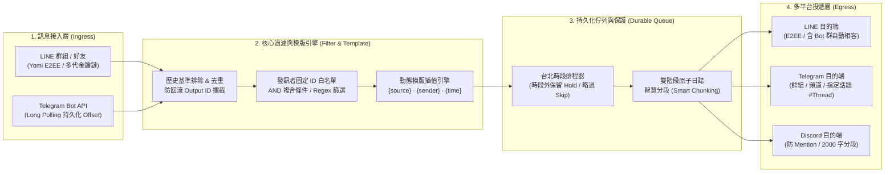

<div align="center">

# ⇄ LinePort

**企業級 Windows 跨平台即時通訊路由與訊息中繼引擎**  
*LINE · Telegram (含 Forum Topics) · Discord — 本機自主運行、端對端加密相容、零外部雲端中轉*

[](https://github.com/b40609/LinePort/releases/tag/v1.0.0)
[](https://github.com/b40609/LinePort/releases)
[](yomi-probe/VERIFICATION.md)
[](SECURITY.md)
[](LICENSE)

[立即下載](#-立即下載安裝與便攜版) · [核心亮點](#-核心架構亮點) · [快速上手](#-三分鐘快速上手) · [進階篩選與模版](#-進階篩選與動態模版語法) · [裝置共存策略](#-line-雙協定身分與官方電腦版共存策略) · [系統架構](#-系統架構與可靠性設計) · [資安與驗證](#-資安防線與自動化驗證)

</div>

---

## 📦 立即下載（安裝與便攜版）

LinePort 提供三種開箱即用的 Windows x64 發行套件，**全數內建執行環境（Node.js 與 .NET Runtime）**，使用者無須安裝任何開發工具或輸入終端機指令：

| 發行版本 | 推薦對象 | 產品特性與啟動方式 | 下載連結 |
| :--- | :--- | :--- | :--- |
| **Windows 安裝版**<br>`Setup.exe` | **一般使用者首選** | 免管理員權限一鍵安裝；自動建立桌面與開始功能表捷徑、支援登入 Windows 自動啟動、舊版平滑熱升級。 | [**下載 v1.0.0 安裝版 EXE**](https://github.com/b40609/LinePort/releases/download/v1.0.0/LinePort-v1.0.0-Windows-x64-Setup.exe) |
| **Desktop 獨立桌面版**<br>`Desktop-Portable.zip` | **重度桌面常駐用戶** | **OmniRoute 同款獨立原生視窗**；免開外部瀏覽器，支援右下角系統匣（System Tray）縮小常駐、單一實例鎖定。 | [**下載 v1.0.0 獨立桌面版 ZIP**](https://github.com/b40609/LinePort/releases/download/v1.0.0/LinePort-v1.0.0-Desktop-Portable-x64.zip) |
| **Windows 標準免安裝版**<br>`Windows-x64.zip` | **綠色環境 / 隨身部署** | 完整解壓至任意資料夾後雙擊 `LinePort.exe` 即可啟動背景服務並開啟本機控制台。 | [**下載 v1.0.0 標準免安裝 ZIP**](https://github.com/b40609/LinePort/releases/download/v1.0.0/LinePort-v1.0.0-Windows-x64.zip) |

> **完整性驗證與版本資訊**：[v1.0.0 發布說明](docs/RELEASE-1.0.0.md) · [SHA256SUMS.txt 校驗檔](https://github.com/b40609/LinePort/releases/download/v1.0.0/SHA256SUMS.txt) · [原始碼壓縮包](https://github.com/b40609/LinePort/releases/download/v1.0.0/LinePort-v1.0.0.zip) · [免安裝與升級指南](docs/PORTABLE.md)

---

## ✨ 核心架構亮點

LinePort 專為高可靠度的跨平台訊號轉發、投研情報匯流與社群訊息分流設計，具備以下六大工程級特性：

### 1. 多對多跨平台網狀路由（M × N Mesh Routing）
- **多來源匯流與多目的分發**：支援最多 30 條獨立規則（每條規則 1–10 個來源、1–10 個目的，最高 100 組並行配對）。
- **跨平台雙向互通**：
  - **LINE**：支援已加入的一般群組、好友私訊；目的端預設啟用 **Letter Sealing (E2EE) 端對端加密**，若偵測到目的群組含不支援 E2EE 之官方帳號／Bot，自動無縫切換為傳輸加密相容模式。
  - **Telegram**：基於官方 Bot API，支援群組、頻道、私訊，並深度整合 **Forum Topics（群組話題專區）** 指定話題投遞。
  - **Discord**：支援伺服器一般文字頻道作為轉發目的，自動抑制 `@everyone` 誤觸提及與外連預覽污染。

### 2. 動態訊息模版與複合語法過濾引擎
- **動態變數插值（Dynamic Templating）**：支援於訊息前綴或自訂模版嵌入 `{source}`、`{sender}`、`{date}`、`{time}`、`{timeShort}`、`{text}`，自動將平台代號映射為本機自訂別名。
- **複合 AND 邏輯與 Regex 正規表達式**：除了多行 `OR` 包含／排除字詞外，單行支援 `詞彙A + 詞彙B`（AND 同時命中）與 `/正規表達式/i`，精準攔截關鍵情報並過濾日常閒聊。
- **固定發訊者 ID 白名單**：各來源可獨立勾選特定成員（基於底層固定識別碼 MID / User ID），無懼群組成員頻繁更改暱稱或頭像。

### 3. 獨家雙協定身分：與官方 Windows 電腦版 LINE 和平共存
- 提供 **`IOSIPAD`（iPad QR 協定身分）** 與 **`DESKTOPMAC`（桌面授權身分）** 雙模式切換，無須擁有實體 iPad 或 Mac。
- 透過 `IOSIPAD` 協定身分登入，可避免觸發 LINE 單一桌面追加裝置互踢機制，讓使用者在同一台電腦上**同時開啟官方 Windows 電腦版 LINE 與 LinePort**。
- **零已讀干擾（Zero Read-Receipt Intrusion）**：LinePort 背景拉取與轉送 LINE 訊息時，**不會將來源聊天室標記為已讀**（維持未讀狀態供使用者於官方客戶端親自查閱）。

### 4. 企業級容錯韌性（BMAD / CE Architecture）
- **超長訊息自動智慧分段（Smart Chunking）**：突破 Telegram（4,096 字元）與 Discord（2,000 字元）單則長度限制，自動優先於段落或換行邊界切分並附加 `(1/N)` 頁碼依序發送。
- **雙階段持久化佇列（Two-Phase Journal）**：每筆轉送皆經 `pending` → `sending` → `sent` 原子寫入與磁碟預檢；若發送途中斷網或結果不明，自動鎖定該配對待人工核對，**重啟絕不重複發送**。
- **故障隔離（Fault Isolation）**：單一目的端受阻或觸發 429 限流時，僅該路線進入退避等待，其餘跨平台路線持續全速運作。
- **Windows 原生系統通知**：當 LINE 授權失效或異常斷線時，立即於桌面右下角彈出原生氣泡通知（含 30 秒防抖節流）。

### 5. 原生桌面體驗與無縫生命週期管理
- **Electron 獨立桌面視窗 + 系統匣常駐**：支援點擊關閉最小化至系統匣（Close-to-Tray）、托盤右鍵快捷選單與單一程序鎖定。
- **開機自動啟動（Autostart）**：提供安裝精靈選項與控制台雙開關（「自動啟動本機服務」與「自動開始背景轉送」可獨立控制）。
- **一鍵模擬與規則健檢**：內建不發訊的「規則沙盒模擬器」與「路線權限預檢」，修改規則前即可百分之百預知過濾與排版結果。

### 6. 國防級本機資安與隱私邊界
- **零雲端中轉**：100% 於使用者本機執行，無外部中繼伺服器、無遙測追蹤。
- **Windows DPAPI 硬體級憑證保護**：Bot Token 支援綁定當前 Windows 使用者帳戶與專屬熵值加密儲存。
- **嚴格本機 API 防護**：控制台僅綁定 `127.0.0.1`，強制檢驗 `timingSafeEqual` 隨機 Token、Nonce CSP (`default-src 'none'`) 與 `Sec-Fetch-Site: same-origin`，免疫 CSRF 與 DNS Rebinding 攻擊。

---

## 🧭 系統架構與可靠性設計



---

## 🚀 三分鐘快速上手

### 步驟 1：啟動程式並連結平台帳號
1. 下載並執行 **Windows 安裝版 (`Setup.exe`)** 或解壓縮 **Desktop 獨立桌面版**，雙擊 `LinePort.exe`。
2. **連結 LINE（選用）**：
   - 若同一台電腦需同時使用官方 Windows 電腦版 LINE，請於「1. 連結帳號」展開登入方式，選擇 **`保留官方電腦版：iPad QR（實驗）`**，點擊「切換身分並重啟服務」，再使用手機 LINE 掃描畫面上的 QR Code。
   - 登入成功後，系統會自動載入所有已加入的 LINE 群組與好友清單，並修復多代 E2EE 金鑰鏈。
3. **連結 Telegram / Discord（選用）**：
   - 填入從 `@BotFather` 取得的 Telegram Bot Token（建議勾選 **Windows DPAPI 保護**），點擊「載入 Bot 聊天室與話題」或手動輸入群組 ID（如 `-100xxxxxxxxxx`）與話題 ID（`threadId`）。

### 步驟 2：建立轉發規則與模擬預覽
1. 切換至「**2. 設定規則**」→ 點擊「**＋ 新增規則**」。
2. **選擇來源與發訊者**：勾選單一或多個來源聊天室；可針對個別來源設定「所有發訊者」或勾選「指定成員」（支援設定本機易讀別名）。
3. **選擇目的與話題**：勾選要轉達的 LINE、Telegram（可於下拉選單指定發送至特定 **話題 #ID**）或 Discord 頻道。
4. **設定篩選與模版**：設定包含／排除關鍵字、自訂訊息前綴模版及台北生效時段，透過下方「模擬目前編輯的規則」確認無誤後點擊保存。

### 步驟 3：啟動背景轉送與常駐
1. 切換至「**3. 啟動與狀態**」→ 點擊「**開始轉送**」。
2. 首次啟動會自動建立歷史基準（略過啟動前的舊訊息，僅轉送啟動後的新訊息）。
3. 若需要開機自動運作，可於「**設定與診斷 → 開機自動啟動**」勾選「登入時啟動本機服務」與「登入時自動開始轉送」。

---

## 🧩 進階篩選與動態模版語法

### 1. 動態訊息模版變數（填入「訊息前綴／格式模版」）

| 變數語法 | 展開說明 | 實際輸出範例 |
| :--- | :--- | :--- |
| `{source}` | 來源聊天室顯示名稱 | `台股產業研究群` |
| `{sender}` | 發訊者名稱（優先順序：本機自訂別名 → 平台名稱 → 固定 ID） | `王研究員` |
| `{date}` | 訊息建立日期（台北時區 `YYYY-MM-DD`） | `2026-10-29` |
| `{time}` | 訊息建立完整時間（台北時區 `HH:mm:ss`） | `14:32:08` |
| `{timeShort}` | 訊息建立簡短時間（台北時區 `HH:mm`） | `14:32` |
| `{text}` | 原始訊息內文（若模版未含 `{text}`，內文會自動接在模版後方） | `2330 法說會重點整理...` |

- **模版設定範例**：`[{source} | {sender} {timeShort}] `  
  **轉發呈現結果**：`[台股產業研究群 | 王研究員 14:32] 2330 法說會重點整理...`

### 2. 進階關鍵字匹配語法（填入「包含關鍵字」）

| 匹配模式 | 語法格式 | 範例 | 觸發條件說明 |
| :--- | :--- | :--- | :--- |
| **一般字面匹配** | 直接輸入文字（不分大小寫） | `法說會` | 訊息內含「法說會」即命中；多行之間為 **OR（任一符合）**。 |
| **複合 AND 邏輯** | `詞彙A + 詞彙B` 或 `詞彙A AND 詞彙B` | `2330 + 買進`<br>`營收 AND 創高` | 同一則訊息必須**同時包含**行內所有指定詞彙才命中。 |
| **正規表達式 (Regex)** | `/pattern/flags`（長度上限 256 字元） | `/\b(2330\|2454)\b.*目標價/i` | 符合正規表達式規則即命中（預設自動附加 `i` 不分大小寫）。 |

---

## 💻 LINE 雙協定身分與官方電腦版共存策略

LINE 官方架構針對同一種「追加裝置類別」採單一登入限制。LinePort 將**主機作業系統**與**LINE 協定登入身分**完全解耦，讓使用者依日常工作環境自由選擇（各身分的憑證、E2EE 金鑰與規則完全隔離保存）：

| 使用者工作情境 | 建議選擇的 LinePort 身分 | 登入方式 | 共存效果與注意事項 |
| :--- | :--- | :--- | :--- |
| **需要在同一台電腦同時使用「官方 Windows 電腦版 LINE」與 LinePort** | **`IOSIPAD`**<br>（iPad QR 協定身分） | 手機 LINE 掃描 QR Code + PIN 驗證 | **不會踢掉官方 Windows 電腦版 LINE**；無須擁有實體 iPad。（若您原本有使用實體 iPad 登入同帳號，實體 iPad 會登出） |
| **不使用官方電腦版，或需要保留實體 iPad 上的 LINE 登入** | **`DESKTOPMAC`**<br>（原有桌面授權身分） | 手機號碼 + 手機授權碼驗證 | 沿用桌面版協定；啟動時可能使其他已登入的官方電腦版 LINE 登出。 |

> 完整相容性驗證細節請參閱：[裝置身分選擇與相容性矩陣](docs/COMPATIBILITY.md) · [iPad QR 實驗與多代金鑰修復紀錄](docs/IPAD-EXPERIMENT.md) · [LINE 已讀零干擾實測報告](docs/READ-RECEIPT-2026-10-10.md)

---

## 📊 平台支援規格與系統邊界

| 規格維度 | 支援細節與系統限制 |
| :--- | :--- |
| **作業系統** | Windows 11 x64（安裝版與免安裝版均內建 Node.js 26.x 與 .NET 10 Windows Desktop Runtime） |
| **LINE 支援範圍** | 個人帳號協定（基於 `@rikaidev/yomi`）；支援已加入的一般群組、好友私訊；支援 E2EE 群組與含官方 Bot 群組自動相容 |
| **Telegram 支援範圍** | 官方 Bot API；支援一般群組、超級群組（含 **Forum Topics 指定話題 ID**）、頻道與個人私訊 |
| **Discord 支援範圍** | 官方 Bot API；僅作為轉發目的端（一般伺服器文字頻道），自動停用提及與連結預覽 |
| **文字與分段處理** | 支援純文字、動態變數模版；超過 Telegram (4,096 字) 或 Discord (2,000 字) 自動按段落切分 `(1/N)` 連續發送 |
| **媒體與回覆關聯** | 選用支援 Telegram → Telegram 圖片（<= 10 MB）／檔案（<= 50 MB）；Telegram → LINE 支援 JPEG／PNG 圖片；支援同路線回覆引用對照 |
| **儲存保護上限** | 單一日誌檔上限 16 MiB、總日誌上限 256 MiB、磁碟剩餘空間低於 64 MiB 時自動進入保護暫停，防止耗盡系統磁碟 |
| **明確不支援項目** | LINE OpenChat（社群）、LINE 來源圖片／檔案讀取、LINE 贴圖／相簿／影音轉傳、Discord 來源讀取、已發送訊息之編輯／收回同步 |

> **免責與合規聲明**：LINE 連線採用非官方個人帳號協定，存在受平台限制或停權之潛在風險，請遵守 [LINE 服務條款](https://terms.line.me/line_terms?lang=zh-Hant) 並自行評估風險。本專案與 LINE Corporation、Telegram、Discord 及 Yomi 無任何官方附屬關係。

---

## 🛡️ 資安防線與自動化驗證

LinePort 採用高標準防禦性軟體工程（Defensive Security Engineering），所有程式碼均通過 **Cloudflare `security-audit`** 規範審查與 **308 項離線單元／整合測試**：

- **零真實憑證測試**：測試套件 100% 採用合成金鑰（Synthetic X25519 Keychains）與本機 Mock 伺服器，絕不接觸真實帳號資料或對外發送網路請求。
- **桌面殼層安全隔離**：Electron 強制啟用 `contextIsolation: true`、`sandbox: true`、`nodeIntegration: false`，並實作 `http:` / `https:` 外部連結 Scheme 白名單與導航攔截。
- **防篡改模組掛載**：針對底層 Yomi E2EE 多代金鑰相容修補（`yomi-e2ee-compat.mjs`），採用檔案 SHA-256 雜湊校驗守衛，拒絕載入任何未經審查之變動模組。

### 開發者本機建置與測試指令

```powershell
# 1. 執行完整 308 項自動化單元與安全測試
cd yomi-probe
npm.cmd ci --ignore-scripts
npm.cmd test

# 2. 啟動純記憶體 UI 模擬沙盒（Port 18767，無須真實帳號即可體驗完整介面）
node ui-mock.mjs

# 3. 建置免安裝包與 Windows Setup.exe 安裝程式
pwsh -File scripts/Build-Portable.ps1 -OutputDirectory dist/portable-v1.0.0
pwsh -File scripts/Build-Installer.ps1 -PortableDirectory dist/portable-v1.0.0 -OutputDirectory dist/installer-v1.0.0 -IsccPath <ISCC.exe路徑>
```

---

## 📚 完整技術文件索引

- **安裝與使用**：[安裝教學](docs/INSTALL.md) · [完整操作手冊](docs/USAGE.md) · [免安裝與平滑升級](docs/PORTABLE.md) · [疑難排解指南](docs/TROUBLESHOOTING.md)
- **路由與相容性**：[多來源路由與篩選規則](docs/ROUTING.md) · [LINE 裝置身分相容性矩陣](docs/COMPATIBILITY.md) · [iPad QR 協定研究紀錄](docs/IPAD-EXPERIMENT.md)
- **系統設計與驗證**：[系統架構設計](docs/ARCHITECTURE.md) · [資安政策與威脅模型](SECURITY.md) · [資料保存與隱私邊界](docs/DATA-RETENTION.md) · [歷次實機與自動化驗證紀錄](yomi-probe/VERIFICATION.md)

---

## 📄 授權條款 (License)

本專案採用 [MIT License](LICENSE) 開源授權。核心協定依賴包含 `@rikaidev/yomi` (MIT)、`tweetnacl` 與 `qrcode`，完整第三方授權聲明請見 [THIRD_PARTY_NOTICES.md](THIRD_PARTY_NOTICES.md)。
