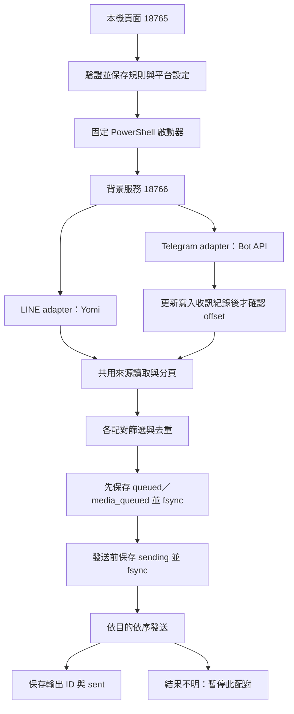

# 運作原理

> DESKTOPWIN 僅保留底層相容性、既有啟動器與獨立資料，未做真實登入或共存驗收；一般選單及切換 API 不開放此身分。它與 DESKTOPMAC 使用相同桌面授權流程，尚無已驗證的使用優勢，不作為官方 iPad 共存建議。

v0.6.0 將來源讀取、持久待送與目的發送分開。LINE 使用 Yomi 非官方個人帳號協定；Telegram 使用官方 Bot API 長輪詢；Discord 只作官方 REST 文字目的。新增作者、時段與 Telegram 媒體選項預設關閉或不限制。

## 服務與介面

LinePort 主機作業系統、主要裝置與 LINE 協定身分分開處理；目前主機整合仍限 Windows。一般帳號連結頁只提供 **原有桌面授權（DESKTOPMAC）** 與 **iPad QR 登入（IOSIPAD，實驗）**。要保留官方電腦版時先選本次實測的 iPad QR；沿用既有登入與設定則選原有桌面授權，後者可能使官方電腦版登出。需要保留官方 iPad LINE 時，目前沒有已驗證方案，可另行驗收原有桌面授權。選擇不依主機或手機品牌決定，無需實體 iPad／Mac。[相容性矩陣](COMPATIBILITY.md)

「帳號連結」頁呼叫受本機 Token 保護的 `/api/device`，要求轉送停止且無其他操作。`device-restart.mjs` 先準備獨立子程序，再釋放舊監聽埠、啟用新服務；失敗恢復舊服務。新程序使用所選身分的獨立資料目錄，不移轉憑證、自動登入或啟動轉送，頁面重載取得新的本機 Token。一般啟動器重用目前模式；完全停止後未指定身分仍預設 `DESKTOPMAC`。

18765 管理登入、規則、Telegram 設定與 LINE 預覽；18766 是獨立背景程序，關閉網頁不停止。啟動器驗證版本 3、設定摘要與就緒狀態，避免沿用其他規則。修改設定前必須停止。

LINE 來源／目的限定已加入的一般群組及好友，不支援 OpenChat。Telegram 使用 Bot 身分，不登入使用者的個人帳號。目的文字由 LINE 帳號或 Bot 重新發送，不保留原發訊者身分。

## 規則與識別

每條規則保存穩定 ID，包含多個來源、目的、每來源作者白名單、關鍵字、前綴及選用時段／媒體。所有來源乘以所有目的形成獨立配對。以平台與聊天室 ID 辨識，不依名稱定位。

配對紀錄識別包含規則 ID、兩端帳號身分與來源／目的 ID。改名稱沿用同一紀錄；新增規則或更換端點／帳號採新識別與基準。舊版按名稱建立的單配對紀錄不自動遷移。

啟用規則驗證重複邊與有向循環，阻擋 A → B → A；自己成功送出的訊息 ID 另存至輸出紀錄，避免它在下游來源再次轉送。這不會識別其他帳號或外部工具重新貼上的相同文字。

## 來源讀取與首次基準

首次讀取快照內的歷史 ID 與基準時間一次保存並同步到磁碟，不發送；重啟載入基準與既有已處理 ID。首次快照期間出現的文字若已在快照內，也略過。

同一 LINE 來源每輪只讀一次，供全部配對共用。最近 50 則不足時，利用公開的前一頁介面繼續查詢，最多 20 頁／1,000 則。查到各配對共用的已處理位置、舊於基準或資料結束才停；游標不前進、缺少游標或超過上限會報錯，避免悄悄截斷。

Telegram 由獨立長輪詢讀取更新。保存選定來源可轉的文字及圖片／檔案資訊；受保護、付費、限時內容排除，一般 Bot 訊息排除，匿名來源僅採 sender_chat。其他更新也保存處理位置。每筆紀錄 fsync 成功後才能推進 offset，下次 getUpdates 才確認前批更新。重啟可讀取已保存但尚未處理的內容。檔案損壞、寫入失敗、容量預檢受阻或收件達 50,000 則時停止讀取，不自動刪資料。

來源讀取錯誤採 3、6、12、24、48、60 秒退避；其他來源仍繼續。Telegram 網路讀取次數與時間來自真正 getUpdates 成功，不把反覆讀快取計成成功輪詢。

## 各配對發送與故障隔離

訊息通過時間、內容保護、ID 去重、作者與關鍵字條件後，以時間由舊到新排序：

1. 保存 queued 文字或帶版本的 media_queued，fsync 後加入去重與待送集合；未入列不推進 checkpoint。
2. 公平輪流處理待送；確認時段與平台等待期限，發送前保存 sending 並 fsync。
3. 透過目的 adapter 發送；回應必須含有效訊息 ID。
4. 保存目的輸出 ID 與 sent，fsync 後移除記憶體待送並增加成功數，原紀錄保留。

每來源與待送佇列各自工作，完成後等待 3 秒；不同目的可並行，同一目的跨來源依序發送、間隔至少 1.1 秒。來源錯誤另採退避，逾時後保留尚未完成的讀取，避免重疊請求。即使所有來源斷線，已保存待送仍可處理。初始化準備有等待期限；LINE 共用連線及 Telegram 單 Bot 收件仍是平台層的共用依賴。

只有 Telegram／Discord 明確有效 429 會保存 retryAt 並自動重試；保守等待該目的平台所有路線。時段外 hold 保存待送；skip 依訊息時間保存略過證據。媒體轉送見下方「圖片與檔案（v1.2.0）」。

Telegram 的網路例外依 `error.code`／`error.cause.code` 分類（`telegram.mjs` 的 `requestNeverSent`）：DNS 失敗、拒絕連線、網路不可達、連線逾時（`UND_ERR_CONNECT_TIMEOUT`）與 TLS／憑證錯誤代表請求從未建立連線，訊息確定未送達，改保存 `retry` 列並依 5 秒起倍增、上限 5 分鐘的等待自動重試，不鎖定路線；多次連線嘗試（happy eyeballs）只有每一次都屬於上述錯誤才算。分段長文已送出任一段後才失敗時，重試會重複前段，所以仍視為結果不明。請求逾時、`AbortError`、`ECONNRESET`、`UND_ERR_SOCKET`、`EPIPE`、未知錯誤或缺少回應 ID 均視為結果不明，保存 uncertain，暫停該配對。若重啟發現 sending 未完成或 uncertain，保持 blocked，不自動重試；其他配對可繼續。任何必要紀錄寫入失敗也停止相關配對。

| 情況 | 行為 |
| --- | --- |
| 相同文字不同 ID | 分別處理 |
| 沒有可讀文字／解密失敗 | 不發送；顯示來源診斷 |
| 更改關鍵字 | 不會把已略過或已處理的文字全部重算 |
| 重啟同一規則 | 沿用紀錄，補處理仍可查詢或已保存的新文字 |
| 新增規則 | 首次建立新基準，略過當時歷史 |
| 發送結果不明 | 跨重啟持續暫停，人工核對，不自動重送 |
| 一個目的初始化或發送失敗 | 隔離該配對，其他可運作配對繼續 |

## 防無聲死亡（v1.1.0）

**系統健康告警**（`health-alert.mjs`）在介面程序（18765）以獨立計時器每 60 秒檢查一次，讀取已去識別的轉送狀態、LINE 帳號狀態與容量，不在轉送程序（18766）內執行，所以告警逾時或失敗不會影響轉送。事件只有固定幾類：路線 blocked／failed（含 `send_uncertain` 與最多 5 個待核對訊息 ID）、LINE `login_required`、來源連續讀取失敗 5 次、容量達 80% 預警或停機。每個頻道（Windows 通知、Telegram）各自去重：同一事件未恢復前只送一次，簽章（階段、不明數、ID）改變或 6 小時冷卻後才重送；送出失敗下次檢查再試。異常全部消失且轉送回到 running 時送一次恢復通知。Telegram 頻道沿用已保存的 Bot Token，只另存目的聊天室 ID 與選填話題 ID（`lineport-health-alert.json`，與規則分開，不改變規則 revision，也不需停止轉送）；告警內容不含訊息全文、帳號、Token 或原始錯誤。設定備份會帶上告警目的，舊備份沒有此欄位仍可還原。

Windows 本機通知（`windows-notify.mjs`）改用原生 Toast（會留在通知中心），標題與內容只經環境變數傳入固定腳本並做 XML 跳脫；WinRT 不可用時才退回氣球通知，並讓程序存活 12 秒確保顯示。

**開機啟動腳本**（`autostart.mjs`）在 `autostart.json` 與兩支腳本檔頭寫入 `schemaVersion` 與 `writtenByVersion`。版本低於磁碟上已記錄版本的程式不會覆寫（比較規則同 `upgrade-service.ps1`：x.y.z，rc 低於正式版），避免舊版可攜版蓋掉新版設定。服務啟動時若已啟用自動啟動，且腳本由較舊版本或無版本紀錄的程式寫入，會自動重寫。安裝版改依資料夾名稱中的版本挑選最新啟動器，不再依最後修改時間。腳本以 UTF-8 BOM 寫入（Windows PowerShell 5.1 才能正確讀取非 ASCII 路徑），每次啟動與錯誤摘要寫入 `%LOCALAPPDATA%\LinePort\autostart.log`（保留最近 200 行，不含 Token）。

**看門狗**（`watchdog.ps1`，由 `install-watchdog.ps1` 安裝成排程工作 `LinePort-Service-Recovery`：登入時與每 5 分鐘執行）讀取 `autostart.json` 與 `relay-intent.json`（頁面開始／停止轉送時記錄的使用者意圖）。服務無回應且啟用服務自動啟動時，執行 `autostart-service.ps1`；轉送應在執行（自動轉送開啟、使用者沒有手動停止）但程序不存在（phase 為 stopped／unavailable）時，執行 `autostart-relay.ps1`。failed／blocked 需要人工核對，看門狗不處理。15 分鐘內最多自動拉起 3 次，超過即停手並只記一次；紀錄寫入 `watchdog.log`（保留最近 500 行）。診斷 API 需要頁面的一次性 Token，看門狗與既有自動轉送腳本一樣從本機首頁取得，Token 不寫入任何檔案。

## 圖片與檔案（v1.2.0）

規則開啟「圖片／檔案」後，LINE 與 Telegram 來源的圖片和檔案可送往 LINE、Telegram 與 Discord。待送紀錄只存**參照**，不存位元組：Telegram 存同一 Bot 的 `file_id`（加上選填的檔名、0 代表大小未知）；LINE 存訊息 ID 與 OBS 物件參照（`oid`、`sid`，E2EE 附件另含該附件的 `keyMaterial`）。新欄位寫成 `payloadVersion: 2`；舊版能讀的形狀（Telegram、大小已知、無檔名、說明不超過 1,024 字元）仍寫 `payloadVersion: 1`，所以舊紀錄照常讀取，降版時也盡量可讀。

LINE 訊息先依 `contentType` 分類（`line-media.mjs` 的 `normalizeLineMessage`）：0 是文字；1 圖片、14 檔案轉成附件參照、文字清空；其他類型（貼圖、位置、通話、影音等）文字一律清空不轉送。原因是 E2EE 圖片／檔案解密後 `text` 是含 `keyMaterial` 與檔名的 JSON，**v1.1.0 以前會被當成一般文字轉出去**；此修正同時套用到多路線與舊版單路線（`relay.mjs`）。

發送時才下載，只在記憶體驗證：Telegram 經 `getFile` 串流下載（不跟隨轉址、路徑白名單、宣告大小比對、上限 20 MB，這是 Bot API 的下載上限）；LINE 經 Yomi 的 OBS 下載，E2EE 附件先驗 MAC 再 AES-CTR 解密，舊式非 E2EE 附件走 `/r/talk/m/{id}`。圖片驗檔頭（JPEG、PNG、GIF、WebP）；檔名用 `safeFileName` 清成單一路徑片段（去控制字元、`<>:"/\|?*`、雙向控制字元、Windows 保留名，最長 120 字並保留副檔名）。目的端：Telegram 同 Bot 直接引用 `file_id`，LINE 來源則以 multipart `sendPhoto`／`sendDocument` 上傳；LINE 目的 JPEG／PNG 用 `sendImage`，其他圖片與所有檔案用 E2EE `sendFile`，說明另送；Discord 以 multipart（`payload_json` + `files[0]`）上傳，關閉所有提及。說明超過 Telegram 1,024 或 Discord 2,000 字元時，附件不帶說明、說明分段另送。附件已被接受而後續說明失敗時，整筆標為結果不明，不重送。

大小上限：圖片 10 MB、檔案 50 MB（十進位）；Discord 目的 10 MB；Telegram 來源送往 LINE／Discord 受 20 MB 下載上限。**入列時**已可確定超過目的上限（或來源回報格式不支援、超過 50 MB）的附件，改存一則「附件未轉送：檔名 · 大小；原因」文字通知，不暫停整條路線。大小未知的附件在下載時才檢查，超過即在發送前失敗（待送保留、未呼叫目的）。附件的下載與上傳逾時是文字的 4 倍。Bot 群組相容模式仍只支援文字。

## 運維（v1.2.0）

**人工處理積壓預覽與快轉**：待核對列表顯示此路線已排隊的待送則數，以及路線停擺的起點（配對紀錄最後寫入時間，停擺後不再寫入）。每筆有三個選項：確認收到並補送後續積壓（原行為）；確認收到並快轉到現在（審計列 `version: 2`，列出所有被略過的排隊 ID；重啟後此路線的起點移到決策時間，停擺期間的來源舊訊息視為歷史，不再補送；舊版程式讀到 version 2 會拒絕並保持暫停）；略過。

**安全壓縮**：見 [容量與資料保留政策](DATA-RETENTION.md)。

**系統匣狀態燈**（安裝版 `LinePort.exe`）：啟動完成後常駐系統匣（同一 Windows 工作階段只一個，Mutex `Local\LinePort.Tray`；`--tray` 只開系統匣、`--no-tray` 不開，`--verify-package` 不變）。每 15 秒以首頁的一次性 Token 讀 `/api/diagnostics`（只含階段與各路線計數，沒有訊息內容）：綠＝轉送中、黃＝啟動中或部分受阻、紅＝失敗／待核對／服務無回應、灰＝已停止；轉紅時跳一次通知。滑鼠停留顯示路線正常數、待核對數、已送與待送。右鍵：開啟本機頁面、重啟轉送（停止、等到 stopped、再依規則開始）、結束系統匣（背景服務與轉送照常）。服務重啟換 Token 時自動重新取得。

**換版**：服務新增 `POST /api/server/shutdown`（需頁面 Token、轉送已停止、沒有登入進行中），回應 202 後關閉連線並結束程序。`upgrade-service.ps1` 先試這個端點，舊版沒有此端點時才退回 `Stop-Process`。連接埠被 `node.exe` 占用但讀不到命令列（舊服務以系統管理員或其他帳號執行）時，改為明確的中文排查提示，仍不停止任何程序。Discord 目的也共用「確定未送出」判斷，DNS／拒絕連線不再把路線鎖成結果不明。

## 自適應輪詢與跨來源去重（v1.2.0）

**LINE 自適應輪詢**：每個 LINE 來源有新訊息（任一條執行中路線尚未處理的訊息）時維持每 3 秒；連續 10 分鐘沒有新訊息改為 10 秒，30 分鐘後 15 秒；台北時間 01:00–06:00 或此來源的所有規則都在時段外時 30 秒；一讀到新訊息立刻回到 3 秒。Telegram 來源讀本機收件，維持 3 秒。目前間隔顯示在來源狀態的 `pollIntervalMs`。讀取失敗的退避（3 秒起倍增、最長 60 秒）另外計算，不受影響。

**跨來源去重**（規則選項，預設關閉）：開啟後，同一目的在時間窗（1–1,440 分鐘，預設 10）內收到內容相同的文字只轉第一則。比對用原始訊息文字（不含前綴與模版），先做 NFKC、轉小寫、移除空白、標點與符號，再取 SHA-256；附件不去重。被去重的訊息寫成略過紀錄（`baseline`），路線計數 `deduplicated` 加一。時間窗只存在記憶體（每目的最多 5,000 個指紋），服務重啟後重新計算。

## 單筆永久拒絕軟隔離（Soft DLQ，v1.2.0）

只有平台**明確拒絕這一則內容**、而且這則還沒有任何部分送出時，才會隔離這一則並讓後面的訊息繼續：Telegram 413，或 400 且描述是單則問題（檔案識別碼錯誤、檔案過大、文字或說明過長、格式實體無法解析、空白文字、圖片尺寸或處理失敗等）；Discord 413，或 400 且錯誤碼是 50035、50006、40005、50045；附件準備階段確定無法成功的情況（超過大小上限、大小不符、MAC 驗證失敗、無法辨識的圖片格式）。聊天室不存在、Bot 被踢、權限、Token、限流、網路中斷與任何**結果不明**（`send_uncertain`）都不隔離，照舊暫停或重試。

隔離時在該路線的人工決策紀錄追加 `{version:3, id, decision:"skip", quarantined:true, phase:"prepare"|"send", reason, at}`（原因已移除控制字元、最多 200 字），重啟後同樣略過、不重送。連續隔離 3 則後第 4 則不再隔離，改照原流程暫停路線（多半是設定問題）；成功送出一則即重新計算。路線狀態顯示「已隔離」數，「人工處理」列出最近 50 筆；健康告警送一次 `route_quarantined`（本次執行的新隔離才告警，不會擋住恢復通知、也不按 6 小時冷卻重送）。舊版遇到 version 3 紀錄會拒絕載入並保持暫停（安全失敗）。

## 保存與限制

規則與 Bot 設定採寫入臨時檔、fsync、原子更名。配對、輸出、收訊及逐筆人工決策使用追加 JSONL；載入拒絕損壞、不完整末行與未知媒體版本。人工確認收到／略過不重送、不改原檔。Windows 資料目錄只授權目前使用者與 SYSTEM；Bot Token 可選 CurrentUser DPAPI，舊明文副本、LINE 登入／E2EE 及訊息仍未加密。

配對紀錄保存篩選後的待送文字；Telegram 收件另保存選定來源內容。紀錄及去重集合持續增長，以單檔 16 MiB、已知紀錄合計 256 MiB 及磁碟可用空間做保守預檢。私人封存複製已知紀錄並驗證 SHA-256，不刪原檔、不釋放容量、不含憑證，也不是完整備份。v1.2.0 起可在停止後安全壓縮（見「運維」）；仍無多程序交易保護與完整送達保證。請勿啟動多份相同資料目錄的登入／轉送流程。

新增模組：rule-options（作者／時段）、media-payload（媒體參照、版本、上限與檔名清洗）、line-media（LINE 訊息分類、附件下載與發送）、network-errors（Telegram／Discord 共用的「確定未送出」判斷）、source-senders（近期人員）、storage-health（容量／私人封存）、bot-credentials／dpapi（選用憑證保護）、discord（官方目的）。[研究與儲存介面評估](RESEARCH-0.6.0.md)

成功數表示平台回應與本機結果保存成功，不是接收者已讀，也未逐則讀回驗證。[安全說明](../SECURITY.md) · [驗證紀錄](../yomi-probe/VERIFICATION.md)

[早期單配對互動示範](flow.html) 保留作歷史參考，不代表目前多規則架構。
